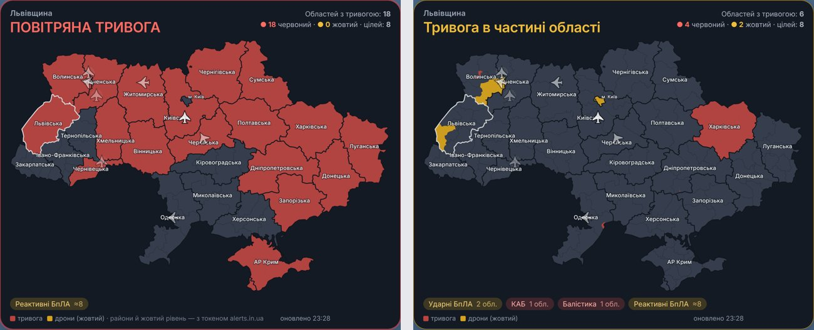

# Карта тривог — віджет для робочого столу macOS

Живий віджет для [Übersicht](https://tracesof.net/uebersicht/): карта України з повітряними тривогами
та загрозами в реальному часі.

*Ліворуч — режим без токена (тривоги по областях), праворуч — з токеном alerts.in.ua (райони, громади, жовтий рівень, типи загроз).*

## Що показує

- **Червоні та жовті тривоги.** Червоний — ракетна або масована загроза, жовтий — дронова (система рівнів з вересня 2026).
  З токеном alerts.in.ua — по областях, районах, громадах і містах; без токена — лише по областях і лише червоним.
- **Цілі на карті** — ударні та реактивні БпЛА, крилаті ракети, балістика, КАБ, авіація. Позиція та напрямок руху
  визначаються з повідомлень публічних Telegram-каналів моніторингу (за замовчуванням Повітряні сили `@kpszsu`,
  `@eRadarrua`, `@war_monitor`). Ціль зникає через 30 хвилин після останньої згадки. Наведіть на іконку — побачите
  вихідне повідомлення.
- **Рядок загроз** — які типи загроз зараз активні.
- **Ваша область** обведена білим, її статус — у заголовку.
- Оновлення кожні 10 секунд (Telegram — раз на 30 секунд).
- Перетягується мишею, розміри S / M / L / XL (кнопки з'являються при наведенні), ↺ — повернути на місце.

> Позиції цілей визначаються автоматично з тексту повідомлень і можуть бути неточними.
> Це неофіційний віджет: орієнтуйтеся на офіційні сигнали тривоги та застосунок «Повітряна тривога».

## Встановлення

1. Отримайте безкоштовний токен API: заповніть форму на [alerts.in.ua/api-request](https://alerts.in.ua/api-request) — токен прийде на пошту.
2. Двічі клацніть `tools/setup.command`: він збереже токен у `~/.config/ua-alerts/token` (доступ лише вам,
   у репозиторій токен не потрапляє), встановить Übersicht, якщо треба, і скопіює віджет.
   Вручну: скопіюйте `alerts-map.widget` у `~/Library/Application Support/Übersicht/widgets/`.
3. У меню Übersicht увімкніть «Launch Übersicht when I login».
3. Якщо віджет зник — перевірте, що Übersicht запущений (іконка в меню-барі), і поставте галочку
   біля `alerts-map` у меню Übersicht → Widgets.

## Налаштування (на початку `alerts-map.widget/index.jsx`)

| Параметр | Що робить |
|---|---|
| `HOME` | ваша область |
| токен | не в коді: файл `~/.config/ua-alerts/token` (створює `tools/setup.command`) |
| `API_MIN_SECONDS` | мінімальна пауза між запитами до alerts.in.ua (8 с; ліміт API — 8–10 запитів/хв) |
| `CHANNELS` | Telegram-канали моніторингу |
| `THREAT_MINUTES` | скільки хвилин показувати ціль |
| `DEFAULT_SIZE` | S (за замовчуванням), M, L або XL |

## Розробка

- Код віджета: `src/widget.src.jsx`. Готовий файл збирається командою
  `python3 tools/build.py src/widget.src.jsx src/geo.js alerts-map.widget/index.jsx` (вбудовує геодані).
- Геодані: `tools/build_geo.py` будує `src/geo.js` з меж OCHA COD-AB (області, 139 районів, 1769 громад, спрощено
  mapshaper) та населених пунктів GeoNames.

## Джерела даних

- Основне джерело — [alerts.in.ua API](https://devs.alerts.in.ua/) `/v1/alerts/active.json`: області, райони, громади, міста,
  рівні (червоний/жовтий) і типи загроз. Запити кешуються і йдуть з `If-Modified-Since`, тож дані завантажуються лише коли змінились.
  Якщо токен недійсний (401) або перевищено ліміт (429), віджет пише про це і переходить на резервне джерело.
- Резервне джерело (без токена): [ubilling.net.ua/aerialalerts](https://ubilling.net.ua/aerialalerts/) — лише області.
- Цілі: публічні Telegram-канали моніторингу.
- Межі: [OCHA COD-AB Ukraine](https://data.humdata.org/dataset/cod-ab-ukr) (CC BY-IGO); населені пункти:
  [GeoNames](https://www.geonames.org/) (CC BY 4.0).
